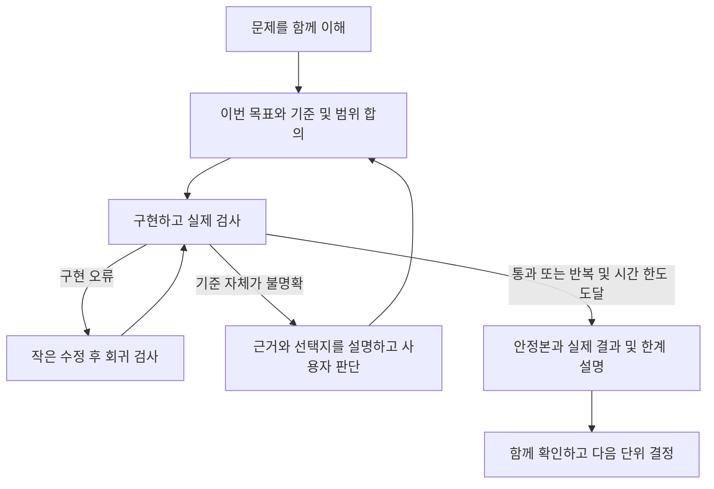

# 이중 루프 적용 방법

문제를 함께 이해하고 이번 작업의 목표·통과 기준·범위를 정한 뒤, 그 범위 안에서 AI가 구현·실행·검사·수정을 반복합니다. 중요한 기준이 불명확하면 근거를 가지고 함께 판단하고, 한 작업 단위가 끝나면 결과를 이해한 뒤 다음 단위를 정합니다. 결과의 정확성과 사용자의 이해를 함께 챙기는 운영 방식입니다.

시작 요청은 [START_HERE.md](START_HERE.md), AI가 따를 지침은 [double-loop-solver](.agents/skills/double-loop-solver/SKILL.md)와 [대화형 진행](.agents/skills/double-loop-solver/references/guided-collaboration.md)에 있습니다.

## 두 루프가 다루는 것

| 구분 | 내부 루프 | 외부 루프 |
| --- | --- | --- |
| 핵심 질문 | 정해진 기준에 맞게 구현했는가 | 목표·가정·해석·자체 판단 기준이 맞는가 |
| 유지하거나 검토할 것 | 합의한 목표·통과 기준·작업 범위는 유지 | 결과를 바꾸는 가정이나 기준을 근거로 재검토 |
| 개선 대상 | 구현, 직접 작성한 작업 프롬프트·예시, 자체 검증 코드 | 잘못 이해한 요구, 미정 업무 정책, 자체 기대값의 의미 |
| 진행 | 동의한 작업 단위 안에서 AI가 실행·검사·수정 | AI가 쟁점·근거·선택지·추천을 설명하고 사용자가 판단 |
| 나오는 결과 | 실행 증거가 있는 후보와 안정본 | 실제 결정과 근거, 필요하면 새 작업 기준 |

외부 루프는 공식 요구사항을 임의로 바꾸는 권한이 아닙니다. 공식 README·원본 자료·공식 검사 기대값은 지켜야 합니다. 업무 담당자의 확인이 필요한 기준은 제공된 문의 경로로 확인합니다. 단순히 다음 단계로 갈지 묻는 것은 진행 확인이며, 목표나 기준 자체를 재검토할 때 외부 루프가 일어납니다.

## 대화형 진행에 연결하기



1. **문제부터 이해합니다.** AI가 상황·목표·입력·필수 결과를 쉬운 예시로 설명합니다. 사용자가 이해했다고 답하기 전에는 풀이 설계나 구현을 시작하지 않습니다.
2. **이번 작업 하나를 정합니다.** 예를 들어 입력 점검, 정정 이력 선택, 로트 집계처럼 사용자가 결과를 이해할 수 있는 크기로 나눕니다. 통과 기준과 검증 방법, 반복·시간 한도도 함께 정합니다.
3. **그 안에서 자동으로 반복합니다.** 실패 원인을 정하고 하나의 논리적 변경을 합니다. 관련 검사와 이전에 통과한 검사를 실제로 실행하고, 결과를 비교해 안정본을 보존합니다. 명령마다 다시 승인받을 필요는 없습니다.
4. **중간에도 설명합니다.** 무엇을 관찰했고 왜 수정하며 무엇을 다시 확인할지 알려줍니다. 예를 들면 “같은 버전에서 기록시각 비교가 빠진 것을 확인해 선택 로직을 수정하고, 기존 경계 사례도 다시 검사하겠습니다”라고 설명합니다.
5. **기준 문제가 나오면 함께 판단합니다.** 이미 정해진 규칙을 코드가 어겼는지, 규칙이나 자체 기대값의 의미부터 불명확한지 구분합니다. 중요한 기준이 미정이면 답이 필요한 작업은 기다립니다.
6. **단위가 끝나면 함께 확인합니다.** 대표 입력 → 적용 규칙 → 결과를 따라가고, 실제 검사와 미검증 사항을 구분합니다. 사용자와 다음 단위를 정한 뒤 이어갑니다.

“수정·재검사 최대 3회”는 조정 가능한 한도의 예입니다. 처음 기준선을 실행한 뒤 개선을 몇 번 시도할지 정하며, 일찍 통과하면 바로 멈출 수 있습니다. 한도까지 통과하지 못했으면 미통과 사실과 가장 나은 상태를 그대로 보고합니다. 이 키트는 반복을 지시하는 문서이며 횟수·대기·시간을 기계적으로 강제하는 실행기는 포함하지 않습니다.

## 범위 변경과 실제 전달까지 연결하기

선택적 기능이나 새 강제 조건을 더할 때는, 현재 입력에서 가능한지 먼저 작게 확인하고 구현뿐 아니라 전체 검증·통합·전달까지의 비용을 다시 본다. 원래 필수·추가 강제·개선 목표·가정을 적용 범위와 함께 구분한다. 실험 후보를 실제 결과로 채택할 때는 같은 조건의 검증과 전달할 소스에서의 재현이 필요하다. 이전에 실행된 화면이나 실험 결과만으로 최신 파일의 동작을 대신하지 않는다.

필요한 절차는 [기준본과 전달본 연결](.agents/skills/double-loop-solver/references/baseline-and-delivery.md)에 있다. 기존 메모와 합의한 작업 단위 안에서 적용하며 명령마다 새 승인이나 추가 문서를 요구하는 절차가 아니다.

## 검사 이력을 다루는 가상 사례

다음은 처리 방식을 설명하기 위한 예시이며 실제 업무 자료나 결과를 옮긴 것이 아닙니다.

**내부 루프 사례:** 업무 규칙에서 대표 버전 선택 순서가 이미 확정됐는데 코드가 과거 버전을 고릅니다. 확정된 규칙으로 기대값을 정하고 선택 로직을 수정합니다. 최신 버전, 같은 버전의 기록시각, 기준시각 경계를 다시 확인합니다. 목표와 통과 기준은 그대로입니다.

**외부 루프 사례:** 보고 기준시각을 실제 검사시각에 적용할지, 정정 기록시각에 적용할지 지시에 없습니다. 두 해석이 결과에 주는 차이를 설명하고 업무 담당자에게 확인할 질문을 정합니다. 실제 답을 받으면 가정과 자체 검사를 갱신하고 그 기준에서 다시 검증합니다. 공식 기준과 충돌하는 선택을 사용자 승인으로 덮어쓰지는 않습니다.

자체 검사 코드의 단순 구현 오류는 근거를 확인해 고칠 수 있습니다. 자체 기대값의 업무적 의미를 바꾸는 수정은 외부 루프에서 검토합니다. 통과 개수나 선택 지표가 좋아져도 필수 조건이 깨진 후보를 안정본으로 승격하지 않습니다. 기준이 바뀌면 새 기준으로 다시 확인하며 이전 기준의 점수를 그대로 비교하지 않습니다.

## 작업 단위를 맡길 때 쓸 말

```text
이번에는 [작업 하나]만 진행하자.
확정한 목표와 통과 기준, 확인 방법을 먼저 짧게 설명해줘.
그 범위 안에서는 구현·실행·검사·수정을 자동으로 반복해줘.
수정·재검사 한도는 우선 최대 3회로 제안하고, 실제 남은 시간에 맞게 조정하자.
중간에도 발견한 문제와 수정 이유를 알려줘.
중요한 기준을 바꿔야 하면 근거와 선택지를 설명하고 내 답을 기다려줘.
끝나면 안정본·실제 검사 결과·한계를 보여주고 다음 단위 전에는 멈춰줘.
```

수정 대상은 현재 목적에 맞게 고릅니다. 코드 수정이 필요한데 무조건 프롬프트를 바꾸거나, 같은 검사를 근거 없이 계속 반복할 필요는 없습니다. 중요한 결정·이유·실행 증거·남은 질문은 기존 작업 기록 하나에 이어 남기면 됩니다.
