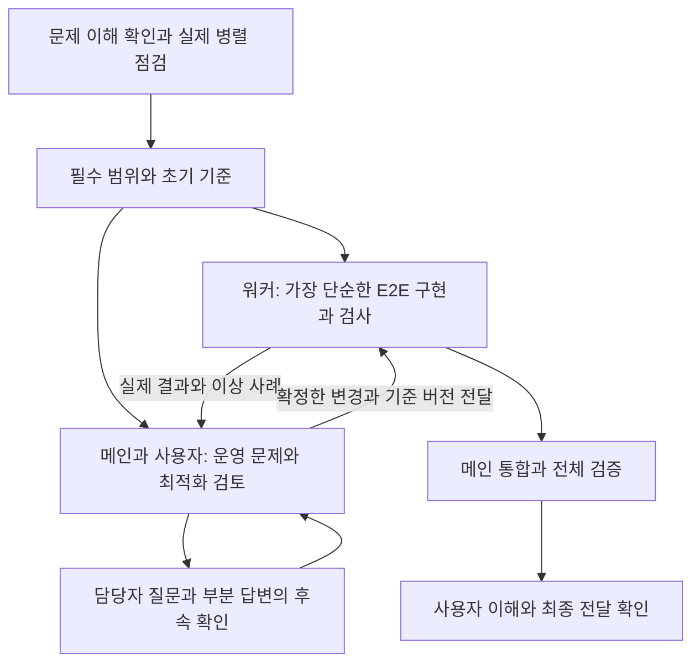

# 이중 루프 적용 방법

문제를 함께 이해하고 이번 작업의 목표·통과 기준·범위를 정한 뒤, 그 범위 안에서 AI가 구현·실행·검사·수정을 반복합니다. 중요한 기준은 메인이 사용자와 판단하고, 워커는 위임받은 E2E 구현을 이어갑니다. 이해를 돕는 설명과 질문은 계속하되 독립적인 구현은 멈추지 않습니다. 결과의 정확성과 사용자의 이해를 함께 챙기는 운영 방식입니다.

시작 요청은 [START_HERE.md](START_HERE.md), AI가 따를 지침은 [double-loop-solver](.agents/skills/double-loop-solver/SKILL.md)와 [대화형 진행](.agents/skills/double-loop-solver/references/guided-collaboration.md)에 있습니다.

## 두 루프가 다루는 것

| 구분 | 내부 루프 | 외부 루프 |
| --- | --- | --- |
| 핵심 질문 | 정해진 기준에 맞게 구현했는가 | 목표·가정·해석·자체 판단 기준이 맞는가 |
| 유지하거나 검토할 것 | 합의한 목표·통과 기준·작업 범위는 유지 | 결과를 바꾸는 가정이나 기준을 근거로 재검토 |
| 개선 대상 | 구현, 직접 작성한 작업 프롬프트·예시, 자체 검증 코드 | 잘못 이해한 요구, 미정 업무 정책, 자체 기대값의 의미 |
| 진행 | 동의한 작업 단위 안에서 AI가 실행·검사·수정 | AI가 쟁점·근거·선택지·추천을 설명하고 사용자가 판단 |
| 나오는 결과 | 실행 증거가 있는 후보와 안정본 | 실제 결정과 근거, 필요하면 새 작업 기준 |

외부 루프는 공식 요구사항을 임의로 바꾸는 권한이 아닙니다. 공식 README·원본 자료·공식 검사 기대값은 지켜야 합니다. 업무 담당자의 확인이 필요한 기준은 제공된 문의 경로로 확인합니다. 단순히 다음 단계로 갈지 묻는 것은 진행 확인이며, 목표나 기준 자체를 재검토할 때 외부 루프가 일어납니다.

## 두 트랙으로 함께 진행하기



1. **처음은 함께 이해합니다.** 상황·입력·필수 결과를 설명하고 사용자의 실제 확인을 기다립니다. 짧은 읽기 전용 점검으로 병렬 기능을 확인하며, 이해 전에는 구현을 시작하지 않습니다.
2. **구현은 위임받은 범위에서 계속합니다.** 시작 요청에 따라 가장 쉬운 유효한 방법을 고르고 최소 E2E를 만듭니다. 작업은 작게 나누되 매 단위마다 재승인을 요구하지 않습니다. 필수 기능과 관련 예외를 생략한 시연을 완성으로 취급하지 않습니다.
3. **메인은 운영 관점의 문제를 찾습니다.** 조건을 모두 통과한 결과도 실제로 유용한지 살펴봅니다. 근사 계산·자원 낭비·처리 누락·평균에 가려진 극단 사례를 실제 근거로 설명하고 중요한 절충을 사용자와 판단합니다.
4. **필요한 답을 좁혀 갑니다.** 담당자의 첫 답변으로 모두 해결됐다고 가정하지 않습니다. 확정된 부분과 미답 부분을 나누고, 사례나 경계 조건으로 후속 질문을 준비합니다. 질문 문안은 메인, 전달과 답 수신은 사용자가 맡습니다.
5. **확정한 변경을 연결합니다.** 메인이 새 기준과 수용 조건을 영향받는 워커에게 직접 전달합니다. 미정 결정에 의존하는 부분만 기다리고 독립 구현은 계속합니다. 새 기준에서 이전 결과를 재검증합니다.
6. **통합과 이해를 함께 확인합니다.** 같은 최종 버전에서 실제 입력·처리·출력과 회귀 검사를 확인하고, 핵심 판단·검증·한계를 설명합니다. 중요한 선택과 전체 중단 요청은 지키되 설명마다 구현을 멈추지는 않습니다.

내부 루프는 유한한 예산 안에서 구현·검사·수정을 반복합니다. 외부 루프는 실패했을 때뿐 아니라 첫 결과와 개선 결과가 나올 때 목표·가정·운영 적합성을 검토합니다. 모든 워커와 실험은 같은 실제 남은 시간을 공유하며, 안정본·통합·이해·전달 시간을 남깁니다. 문서가 병렬 실행이나 턴 종료 뒤 워커 지속을 보장하지 않으므로 실제 관측 범위만 설명합니다.

## 범위 변경과 실제 전달까지 연결하기

선택적 기능이나 새 강제 조건을 더할 때는, 현재 입력에서 가능한지 먼저 작게 확인하고 구현뿐 아니라 전체 검증·통합·전달까지의 비용을 다시 본다. 조건의 출처(문제 필수·사용자 추가·구현 가정)와 집행 방식(강제·기본 기준·개선 목표)을 적용 범위와 함께 구분한다. 사용자 추가 조건은 현재 강제하더라도 사용자 결정으로 완화·변경·철회하거나 특정 대상에 예외를 줄 수 있다. 미처리나 후퇴가 생기면 유망한 실험안을 보존하고, 문제 필수는 지키면서 사용자 조건을 조정해 회복할 방법을 검토한다. 특정 대상이 실제 포함된 묶음 전체에 예외를 적용할 수도 있으며, 재편성마다 적용 대상을 다시 계산한다. 승인된 예외와 나머지 조건을 전체 결과에서 통과하면 정식 후보로 채택할 수 있다. 실험 후보를 실제 결과로 채택할 때는 같은 조건의 검증과 전달할 소스에서의 재현이 필요하다. 이전에 실행된 화면이나 실험 결과만으로 최신 파일의 동작을 대신하지 않는다.

필요한 절차는 [기준본과 전달본 연결](.agents/skills/double-loop-solver/references/baseline-and-delivery.md)에 있다. 기존 메모와 합의한 작업 단위 안에서 적용하며 명령마다 새 승인이나 추가 문서를 요구하는 절차가 아니다.

## 검사 이력을 다루는 가상 사례

다음은 처리 방식을 설명하기 위한 예시이며 실제 업무 자료나 결과를 옮긴 것이 아닙니다.

**내부 루프 사례:** 업무 규칙에서 대표 버전 선택 순서가 이미 확정됐는데 코드가 과거 버전을 고릅니다. 확정된 규칙으로 기대값을 정하고 선택 로직을 수정합니다. 최신 버전, 같은 버전의 기록시각, 기준시각 경계를 다시 확인합니다. 목표와 통과 기준은 그대로입니다.

**외부 루프 사례:** 보고 기준시각을 실제 검사시각에 적용할지, 정정 기록시각에 적용할지 지시에 없습니다. 두 해석이 결과에 주는 차이를 설명하고 업무 담당자에게 확인할 질문을 정합니다. 실제 답을 받으면 가정과 자체 검사를 갱신하고 그 기준에서 다시 검증합니다. 공식 기준과 충돌하는 선택을 사용자 승인으로 덮어쓰지는 않습니다.

자체 검사 코드의 단순 구현 오류는 근거를 확인해 고칠 수 있습니다. 자체 기대값의 업무적 의미를 바꾸는 수정은 외부 루프에서 검토합니다. 통과 개수나 선택 지표가 좋아져도 필수 조건이 깨진 후보를 안정본으로 승격하지 않습니다. 기준이 바뀌면 새 기준으로 다시 확인하며 이전 기준의 점수를 그대로 비교하지 않습니다.

## 특정 단위만 함께 확인하고 싶을 때

기본 두 트랙 진행 중에도 아래처럼 범위를 좁혀 단계별 확인으로 바꿀 수 있습니다. 이 요청의 정지 범위와 영향을 확인하고 따릅니다.

```text
이번에는 [작업 하나]만 진행하자.
확정한 목표와 통과 기준, 확인 방법을 먼저 짧게 설명해줘.
그 범위 안에서는 구현·실행·검사·수정을 자동으로 반복해줘.
수정·재검사 한도는 우선 최대 3회로 제안하고, 실제 남은 시간에 맞게 조정하자.
중간에도 발견한 문제와 수정 이유를 알려줘.
중요한 기준을 바꿔야 하면 근거와 선택지를 설명하고 내 답을 기다려줘.
끝나면 안정본·실제 검사 결과·한계를 보여주고 다음 단위 전에는 멈춰줘.
```

수정 대상은 현재 목적에 맞게 고릅니다. 코드 수정이 필요한데 무조건 프롬프트를 바꾸거나, 같은 검사를 근거 없이 계속 반복할 필요는 없습니다. 중요한 결정·이유·실행 증거·남은 질문은 기존 작업 기록 하나에 이어 남기면 됩니다.
